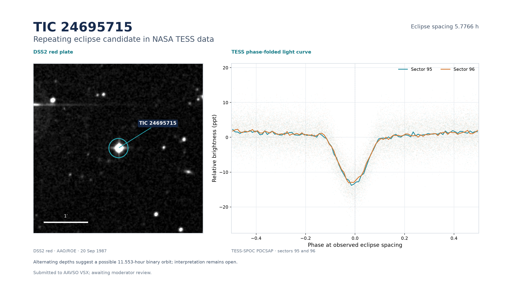

# All-sky TESS scout: TIC 24695715

The share image pairs a Digitized Sky Survey 2 red-plate cutout with the TESS-SPOC phase-folded photometry. The archival sky image is from the AAO/ROE UK Schmidt plate observed on 1987-09-20; [download the field image](tic-24695715-sky.jpg) or view the [original DSS cutout at STScI](https://archive.stsci.edu/cgi-bin/dss_search?v=poss2ukstu_red&r=25.06210645&d=-67.81509844&e=J2000&h=6&w=6&f=fits&c=none).

## Search

Sky sampled 180 targets from each of 11 widely spaced sector pairs (1/2, 11/12, 21/22, 31/32, 43/44, 53/54, 63/64, 75/76, 85/86, 95/96, 105/106): 1,980 targets total. The scans returned 43 repeaters. Many of the loudest signals were already catalogued as known eclipsing or pulsating variables.

This is a broad pilot, not a complete all-sky census. It covered the selected two-minute targets, not every star in each TESS field.

## Best unlisted lead from the pilot

TIC 24695715 has a repeated eclipse signal with successive dips spaced by 0.2406914 days (5.7766 hours). The fitted duration is about 1.24 hours and depth about 1.31%. Its TESS magnitude is 12.25. The event spacing may be half the true orbital period; see the parity check below.

The signal is also present in TESS full-frame cutouts from sectors 1, 2, 29, 68, and 69. At the fitted period, phase-fitted depths are 0.88–1.08%, with BLS signal-to-noise 41.8–72.3. A linear ephemeris spanning the old cutouts and the sector 95/96 fit has 2.4-minute RMS timing residuals.

Target-pixel difference images from sectors 95 and 96 put the variable source 4.2 and 2.0 arcseconds from the TIC coordinates, respectively, consistent with the target. Gaia DR3 has a nearby match 0.55 arcseconds away, with G=12.72 and BP−RP=0.87; its variability flag is unavailable.

Cross-checks found no TIC match in five published TESS eclipsing-binary tables, no VSX entry within 36 arcseconds, no NASA Exoplanet Archive TOI entry, and no public SPOC TCE row for this target in sectors 95 or 96. SIMBAD returns UCAC4 111-001466 at the position. Exact TIC, Gaia DR3, and UCAC4 web searches returned no relevant results.

## Planet-versus-binary check

The 5.7766-hour interval may be half the true orbital period. Comparing adjacent eclipse measurements gives deeper even-numbered events in both the sector 95/96 data and the older, widely separated TESS cutouts. The paired mean depth differences are 0.090 percentage points across 38 event pairs in sectors 95/96 and 0.136 percentage points across 40 pairs in the older cutouts. The direction repeats across the independent baselines. [Folding at twice the interval](period-alias-check.png) shows the two alternating eclipses near phases 0 and 0.5. This pattern makes an eclipsing binary a stronger explanation than a planet transiting every 5.7766 hours, although the physical interpretation is not confirmed.

The host-star size is not settled. TIC v8.2 gives a radius of 0.96 solar radii, while Gaia DR3 gives 1.45 solar radii from FLAME and 1.83 solar radii from GSP-Phot. Gaia also reports RUWE 8.92 and astrometric excess noise 1.22 mas, so its single-source astrometric/stellar solution is anomalous. At the measured 1.31% depth, a simple undiluted transit estimate would imply about 1.1 Jupiter radii using the TIC radius, but 1.6–2.0 Jupiter radii using Gaia's radii. These are rough estimates, and the input-radius disagreement plus alternating depths prevents a reliable planet-radius claim.

The TIC contamination ratio is 0.00035 and SPOC crowding metrics are 0.982 and 0.986 for sectors 95 and 96. The nearest TIC catalog neighbor is 43 arcseconds away and much fainter, which argues against a bright, wide contaminant. It does not rule out an unresolved close companion. The Gaia DR3 source has no Gaia variability classification or NSS two-body/acceleration solution. Searches found no NASA Exoplanet Archive TOI match and no public SPOC TCE row in sectors 95 or 96.

The submitted VSX entry used the 5.7766-hour eclipse spacing as its period. This new parity check raises a possible 11.553-hour orbital period; a physical binary/transit fit and an amendment to the pending submission should be considered before claiming a planet. Full details and calculations are in [exoplanet-assessment.md](exoplanet-assessment.md) and [exoplanet-assessment.json](exoplanet-assessment.json).

The candidate was submitted to AAVSO VSX with the provisional designation TIC 24695715 and is awaiting moderator review. The submitted support plot is `phase-and-timeseries.png`; the share graphic is `tic-24695715-share.png`. The submission requests discoverer credit as Divy, which VSX moderators may edit.

## Scale-up

The pilot used the smaller, preselected two-minute target lists. TESS-SPOC also provides FFI-derived light curves for up to 160,000 selected targets per sector, sampled at the sector's FFI cadence. That is the practical next layer for expanding coverage: use FFI light curves for a wide, cheap first pass, then use two-minute light curves and pixel products to vet the shortlist. The FFI data products and selection are documented by [MAST's TESS-SPOC archive](https://archive.stsci.edu/hlsp/tess-spoc); TESS cadence varies by mission cycle as described by the [NASA TESS data-products guide](https://heasarc.gsfc.nasa.gov/docs/tess/data-products.html).
